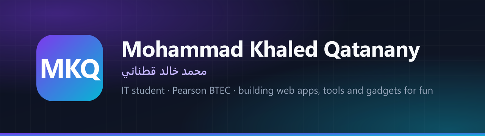

  👋 Hi, I'm Mohammad — an IT student on the Pearson BTEC programme. 
  Outside class I build web apps, small tools and the occasional gadget, mostly to learn how things work. 
  مرحباً، أنا محمد — طالب تكنولوجيا معلومات في برنامج BTEC، أبني تطبيقات ويب وأدوات وأجهزة صغيرة كهواية وللتعلّم.

## 🛠️ Things I've built

<table>
  <tr>
    <td width="50%" valign="top">
      
      <b><a href="https://github.com/mkjq/mkq-vault">MKQ Vault</a></b> 
      Hardware password manager and 2FA generator on an ESP32-S3.
    </td>
    <td width="50%" valign="top">
      
      <b><a href="https://github.com/mkjq/mkq-skills">MKQ Skills</a></b> 
      Arabic platform for writing and organising AI prompt files.
    </td>
  </tr>
  <tr>
    <td valign="top">
      
      <b><a href="https://github.com/mkjq/DevSign-Hub">DevSign Hub</a></b> 
      30 utilities for developers and designers in one web app.
    </td>
    <td valign="top">
      
      <b><a href="https://github.com/mkjq/MKQ-Github-Automator">MKQ GitHub Automator</a></b> 
      Desktop app that makes managing GitHub repos easier.
    </td>
  </tr>
  <tr>
    <td valign="top">
      
      <b><a href="https://github.com/mkjq/ahmad-linktree">LinkTree Studio</a></b> 
      Link-in-bio page with a live-preview dashboard, no backend.
    </td>
    <td valign="top">
      
      <b><a href="https://github.com/mkjq/glasa-galaxy-portal">MKQ Web Tools Hub</a></b> 
      Bilingual home page for my web tools and side projects.
    </td>
  </tr>
  <tr>
    <td valign="top">
      
      <b><a href="https://github.com/mkjq/mkq-project">Awesome MKQ AI Agent</a></b> 
      Guides for using MKQ AI models in agent and coding tools.
    </td>
    <td valign="top"></td>
  </tr>
</table>

## 🧰 Things I like working with

  
  
  
  
  
  
  
  
  
  

## 📫 Find me

🌐 [mkq.one](https://mkq.one)
